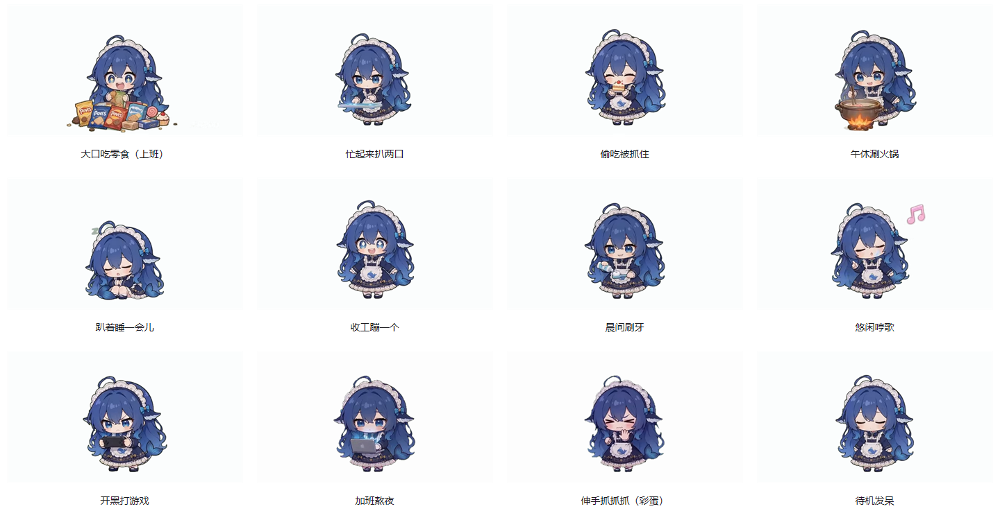

# 打工养肥鱼 · DSH Salary Meter

一边打工，一边看工资涨；一边让 AI 干活，一边看肥鱼吃掉多少“饭钱”。

这是一个把**实时工资、模型费用估算和桌面宠物**放在一起的小工具：蓝毛鲸鱼娘站在桌面上，脚下的余额条显示「今天挣的钱 − 已统计的模型费用」，上班、午休、忙碌、收工时会切换动作。



## 桌面效果

| 收起账目 | 展开账目 |
| --- | --- |
|  |  |

人物和脚下余额条常驻，展开后查看今日账目。截图展示暗金样式，具体金额与状态随你的配置和记录变化。

## 先选安装方式

仓库包含两个配合使用、也可分别使用的部分，**不是同一个安装包**：

| 部分 | 你会看到什么 | 当前发布版本 |
| --- | --- | --- |
| Windows 桌面挂件 | 桌面人物、滚轮金额、今日账目、设置、跨天结算 | [desktop-v0.1.4](https://github.com/Jiang-Xiaoxing/dsh-salary-meter/releases/tag/desktop-v0.1.4)（程序内部版本 0.2.3） |
| DSH 插件 | 启动/管理已有桌面挂件，并写入任务忙闲心跳；当前不再绘制 DSH 内嵌工资条 | [v0.3.3](https://github.com/Jiang-Xiaoxing/dsh-salary-meter/releases/tag/v0.3.3) |

**想要桌面上的肥鱼，请下载桌面挂件。** 安装 DSH 插件不会自动下载桌面 EXE；要联动运行，需要桌面程序已存在、且插件能找到它。桌面版与插件版有各自的数据和功能范围，升级时也请分别更新。

### Windows 桌面挂件

在 [桌面版 v0.1.4 下载页](https://github.com/Jiang-Xiaoxing/dsh-salary-meter/releases/tag/desktop-v0.1.4)选择：

- **SalaryMeter.exe**：免安装，双击运行。
- **SalaryMeter-Setup.exe**：安装版。

更新前先从托盘退出旧挂件，再替换 EXE 或运行新安装包。当前发布的是 **Windows x64** 程序，依赖 WebView2 Runtime；其他平台没有已验证的发布包。

### DSH 插件

在 DSH 的「插件 → 添加插件」填写：

```text
github:Jiang-Xiaoxing/dsh-salary-meter#v0.3.3
```

Web profile 的命令行安装方式：

```sh
dsh plugin --profile web add github:Jiang-Xiaoxing/dsh-salary-meter#v0.3.3
```

安装后按宿主提示刷新或重启。插件兼容声明为 DSH **0.2.1-rc.5**；其他版本请先核对兼容性。

## 桌面版现在能做什么

### 工资、饭钱和滚轮余额

- 根据月薪、每月工作日、上下班时间和午休时长，持续计算今天的工资；午休暂停累计。
- 支持**双休、单休（周日休）、大小周**，显示未开工、上班中、午休中、已下班、休息日及对应倒计时。
- 余额采用**逐位滚轮**：没变化的数字不动，变化的位数按涨跌方向滚动。
- 扣费时金额变红并短暂停住；连续 **3.6 秒**没有新扣费后恢复显示，把期间累计的工资补回。连续扣费最多冻结 **10 秒**。这只是显示效果，不会暂停工资计算或修改实际账目。
- 今日账目分别显示打工入账、肥鱼饭钱和剩余金额。费用是估算，不是银行余额或真实扣款。

### 会跟着状态活动的桌宠

- 内置 **12 段透明 WebM 动画、10 种场景**：吃零食、忙碌、午休火锅/打盹、收工、刷牙、休息/打游戏、加班、被抓住、发呆和彩蛋。
- 点击人物有互动反馈；彩蛋会播放「伸手抓抓抓」，暂时把显示金额变成 0，再恢复真实金额，**不会清空账本**。
- 有插件心跳时按真实任务忙闲切换；心跳不可用时，退回近期扣费和日志活动判断。休息日的游戏动画还会检查电脑是否空闲。
- 普通场景等当前片段播完再切，彩蛋等需要即时反馈的场景可以抢占。
- 视频失败时隐藏人物和气泡，金额面板继续工作，**60 秒后自动重试**，不再切回旧图集。

### 外观与日常操作

- **深色、浅白、暗金**三种配色。
- 人物大小 **80%–160%**，默认 130%，支持恢复默认。
- 点击余额条或状态文字展开/收起今日账目；人物不靠展开账目才出现。
- 拖动挂件可移动并记住位置；点账目右上角 `⋯`、右键人物或托盘菜单进入设置。
- 托盘支持设置、切换配色、始终置顶、鼠标穿透和退出。**当前托盘没有开机自启开关。**

### 设置、自检和跨天结算

- 设置中可看每天工资、本月累计估算，以及**近 1 小时 token/s**。后者由合格已完成回答的输出 token 和流时长计算，不是把 token 总数除以一小时，也不是实时网速。
- 「账目自检与价格信息」显示已算/未算记录和价格来源；可点「重算今天的账」重新扫描。
- 跨天时生成昨日账单，展示收入、饭钱和剩余；未收下的旧账单会保留，新账单排队。
- **「收下」才标记已读**；点 `×` 或 Esc 只是暂时关闭，本次运行不再弹这张，下次启动仍会提醒。
- 结算账本损坏时先备份再重建；跨天使用此前保存的工资配置，不把今天修改的工资倒套到昨天。

默认工资参数：月薪 **5,000 元**、每月 **22 天**、**09:00–18:00**、午休 **1 小时**、双休。午休从 12:00 附近开始并限制在班次内。大小周按固定周序交替，并非可自定义调休的日历。

## 今日账目与三个样式

点击人物脚下的余额条或状态文字，会展开当前的「今日账目」面板：顶部是标题、时间和设置入口，中间是下班倒计时与进度条，底部是「今日入账」和「肥鱼饭钱（估算）」。收起的是账目，不是换回旧版工资条。

设置中的「配色」有三个样式，显示内容和操作一致，只改变颜色：

| 样式 | 视觉特点 |
| --- | --- |
| 深色 | 深灰底、浅色文字、蓝紫色进度条 |
| 浅白 | 浅白底、深色文字、蓝色进度条 |
| 暗金 | 深棕底、金色文字和进度条；上方仓库截图展示此样式 |

上方的收起/展开图片是仓库已有的暗金截图，**不是三个样式各一张**。目前没有在本文附上深色和浅白的新版截图，不以旧图代替。

当前插件只负责桌面程序联动和数据支持，`client.js` 的入口已停止挂载旧的 DSH 内嵌工资条。仓库仍保留部分旧图集代码和图片，但它们不代表当前启用的界面。

## 模型“饭钱”怎么算

挂件**不会为了统计费用额外调用模型**，读取的是宿主已有的用量记录：

| 部分 | 统计来源 |
| --- | --- |
| 桌面挂件 | 扫描本机 DSH/DS Bot 的会话日志，提取当天用量；费用按北京时间归日 |
| DSH 插件 | 监听会话事件并保存当天统计；重算时也会补扫已归档的当天会话 |

内置价格表含 **36 个模型名称/别名条目**，覆盖 DeepSeek、GLM、Step、Kimi、Qwen、MiniMax、OpenAI、Claude、Gemini、Grok。美元价格按 **7.15** 折算人民币；内置价表核对日期为 **2026-11-06**，不是服务商实时账单。

当前实现只对 DeepSeek 应用工作日峰谷规则：周一至周五 09:00–12:00、14:00–18:00 用原价，其他时段五折；其他厂商按表内价格。它不自动处理法定节假日、调休、套餐抵扣、第三方渠道优惠、搜索/抓取或额外辅助调用费用。

插件启动时及之后每 24 小时尝试从仓库更新 `prices.json`（先 jsDelivr，再 GitHub）；失败则使用缓存或内置价格。桌面程序使用内置价表，并可在启动时读取插件留下的价格缓存，**不是独立实时联网报价**。

`≈` 表示估算；记录无法计价时，界面可能显示费用下限、余额上限和“有遗漏”。**没有“有遗漏”也不代表完整**：当前实现会跳过部分未知的非 DeepSeek 模型。实际支出以服务商账单为准。

## 桌面程序与 DSH 怎样联动

插件在 Windows 上会查找已存在的 `SalaryMeter.exe`，找到后尝试启动，已有同路径进程则复用。推荐通过环境变量 **`SALARY_METER_EXE`** 指定 EXE 的完整路径，然后重启 DSH；其他查找位置见 [桌面版说明](desktop/README.md#与-dsh-联动)。

插件启动的挂件跟随宿主退出。手动双击时，若检测到正在运行的 DS Bot 主进程，也会跟随它；没有检测到宿主则可独立运行。不要把它理解为“任何安装方式都必定随 DSH 一起开关”。

## 数据保存在本机哪里

- 插件：`$DSH_HOME/data/dsh-salary-meter/`，未设置时默认 `~/.dsh/data/dsh-salary-meter/`。包含工资配置、历史显示偏好、当天费用和价格缓存。
- 桌面挂件：`%APPDATA%\com.local.salarymeter\`，包含配置、位置、结算记录、任务心跳和运行日志。
- 桌面版会话目录：优先 `DSH_HOME`；否则在存在 `~/.ds-bot/data` 时选 `~/.ds-bot`，再回退 `~/.dsh`。日志位于其 `sessions/<分组>/session-*/session.v4.jsonl.zstd`。

桌面与插件的工资配置分别保存；首次迁移不等于之后会双向实时同步。账目不同请先检查数据目录、配置和价格来源。停用/卸载插件在 DSH 插件页操作；卸载桌面程序前退出挂件，删除数据目录前先备份需要的账单。

## 开发与验证

- 插件核心检查：在仓库根目录运行 `npm test`；插件声明 Node.js ≥22。
- 桌面版使用 **Tauri 2 + Rust + WebView2**，构建步骤、源码目录和检查说明见 [desktop/README.md](desktop/README.md)。
- 桌面版最新发布记录包含扣费冻结、视频层、场景调度和结算等验证结果，但真实零点长时间运行、多显示器和非 150% 缩放仍有待验证项，不能视为全平台保证。
- 已停用内嵌界面的历史动画运行记录见 [animation-validation.md](docs/animation-validation.md)，不代表当前界面；完整版本变化见 [Releases](https://github.com/Jiang-Xiaoxing/dsh-salary-meter/releases)。

本文按 2026-11-09 的仓库代码与发布记录整理；源码已实现、历史测试通过和你本机实际运行通过是不同的状态。

## 素材、致谢与许可

代码采用 [MIT](LICENSE) 许可证。第三方素材和字体保留各自许可：

- 桌宠的十段动画来自 [PC2005-cloud/dsh-pet](https://github.com/PC2005-cloud/dsh-pet) 的 `assets/webm`，按 MIT 使用，许可证见 [LICENSE-dsh-pet](LICENSE-dsh-pet)。
- 「加班熬夜」「伸手抓抓抓」为本项目按绿幕抠像、站位归一化、透明 VP9 流程制作的素材，不是原作者提供的动画。
- 仓库保留的旧 DSH 内嵌图集人物按社区“大肥鱼”鲸鱼娘形象自制，与当前桌面 WebM 动画不同。
- 桌面余额栏打包 Noto Sans CJK SC 字体子集，遵循 SIL OFL 1.1，见 [字体说明](desktop/renderer/assets/fonts/README.md) 与 [OFL](desktop/renderer/assets/fonts/OFL.txt)。
- 感谢社区二创：[吃白饭的大肥鱼](https://www.bilibili.com/video/BV1JFtZ6iEpt/)、[蓝色大肥鱼表情包](https://www.bilibili.com/video/BV1V88G6TEvg/)、[家里来了个吃白饭的大肥鱼](https://www.bilibili.com/video/BV1bXHW66Es5/)，以及 [dsh-sidebar-qa](https://github.com/ChenRuoT/dsh-sidebar-qa) 的插件介绍参考。形象与素材权利归各自作者。
