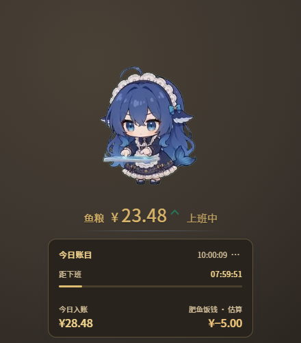

# 打工养肥鱼

桌面上蹲着一只蓝毛鲸鱼娘，替你盯着今天挣了多少钱。

上班那一秒，她脚边的数字就开始涨；AI 花的钱从里面扣。午休她跑去吃火锅、打盹，下班说一句「已收工」，过了零点把昨天的账递给你。

一个 Windows 桌面小挂件，可执行文件 11 MB 出头，双击就能用，不用登录。

| 收起账目 | 展开账目 |
| --- | --- |
|  |  |

> 截图是隔离检查里渲染的，配的是暗金样式，金额为合成数据；实际读数随你的设置走。

## 它大概是这样

- **钱按秒涨**：填一次月薪和上下班时间，之后她自己算。午休自动停，支持双休、单休（周日）和大小周。
- **数字是逐位滚的**：没变的位数不动，变的位数按涨跌方向滚；跨过显示角位（比如 1.19 → 1.20）还会闪一下绿。
- **扣钱时数字红一下**：连续扣费就一直红着，停 3.6 秒没有新账再补回来，最长冻 10 秒。这只是显示效果，不影响账。
- **饭钱不用你记**：读本机已有的用量记录，按模型单价折算；不会为了记账额外调模型，看她不多花钱。
- **能搁在顺手的地方**：置顶、半透明，能拖到桌面任何角落；展开是今日账目，收起只剩一条鱼粮。
- **每天一张昨日账单**：零点后第一次打开会弹出来。点「收下」才算翻篇，点 × 或按 Esc 只是这次不看，下次打开还会提醒。
- **人物放不出来也耽误不了看钱**：视频坏了自动藏起人物，金额照常走，60 秒后自己重试。

## 怎么装

**你要的是桌面挂件**，下载页里也只有它：

1. 打开 [桌面版 v0.1.6 下载页](https://github.com/Jiang-Xiaoxing/dsh-salary-meter/releases/tag/desktop-v0.1.6)，二选一：
   - `SalaryMeter.exe`：免安装，双击直接用；
   - `SalaryMeter-Setup.exe`：安装版，会进开始菜单。
2. 双击运行。第一次可以填月薪、工作日、上下班时间；懒得填就用默认值：月薪 5000 元、每月 22 天、09:00–18:00、午休 1 小时、双休。
3. 想让她跟着 DSH 自动开关，再装插件（见下面「那个插件是干嘛的」）；不装也行，自己双击。

> 只支持 Windows x64，需要系统里的 WebView2（Win10/11 一般自带）。更新前先从托盘退出旧版，再换文件。

## 展开、收起和三种配色

**收起**时只有一条鱼粮：今天到手的钱。**展开**是今日账目：今日入账、肥鱼饭钱（估算）、剩余，外加下班倒计时和进度条。

三种配色，内容和操作完全一样，只换颜色：

| 深色 | 浅白 | 暗金 |
| --- | --- | --- |
| 深蓝灰 · 雾蓝字 | 浅白 · 墨蓝字 | 暖黑 · 浅金字 |
|  |  |  |

人物也能整个关掉：设置里去掉「加载人物动画」，只留鱼粮和账目，顺便省点内存。

## 日常怎么用

- **点鱼粮条或状态文字**：展开／收起账目。收起展开只改窗口高度，顶端不会跳。
- **拖**：挂件能拖到桌面任意位置，位置会记住；就算拖出屏幕，下次启动也会拉回来。
- **点人物**：有互动反馈；点着玩几下会有彩蛋。
- **右键**人物、鱼粮、账目卡，或点账目右上角 `⋯`，或走托盘菜单：打开设置。
- **托盘**还有配色、始终置顶、鼠标穿透和退出。**没有开机自启**——要用就自己开，或者靠插件跟着 DSH 起来。

## 她会动

12 段透明动画、10 种场景：吃零食、忙碌、午休火锅／打盹、收工、刷牙、休息打游戏、加班、被抓住、发呆，外加一个彩蛋。


有插件心跳时，她按你真实的忙闲切换；心跳没有或过期，就退回按最近的扣费和日志活动来猜。普通场景会等这一段播完再切，彩蛋这种要即时反馈的可以直接抢。

## 设置里都有什么

- 工资作息（月薪、工作日、上下班时间、午休）、休息制度（双休／单休／大小周）。
- 配色、人物大小 80%–160%（默认 130%）、人物动画开关。
- 今日入账、本月累计估算、近 1 小时 token/s。
- 账目自检：今天算了几笔、还有几笔算不了、合计多少、价格表从哪来；旁边有个「重算今天的账」可以重扫一遍。

## 模型饭钱怎么算

她不会为了统计费用额外调模型，只是读宿主已经写好的用量记录：

| 部分 | 读哪里 |
| --- | --- |
| 桌面挂件 | 扫本机 DSH／旧 DS Bot 的会话日志，按北京时间归日 |
| DSH 插件 | 监听会话事件，顺便存下当天统计 |

内置价表 36 个模型条目，覆盖 DeepSeek、GLM、Step、Kimi、Qwen、MiniMax、OpenAI、Claude、Gemini、Grok；美元按 7.15 折算，价表核对日期是 2026-11-06。

只有 DeepSeek 用峰谷规则：工作日 09:00–12:00、14:00–18:00 走原价，其余时段五折。法定节假日、调休、套餐抵扣、第三方渠道优惠都不算在内。

数字前面带 `≈` 就是估算。算不出价的记录会标「有遗漏」；没标也不等于一分不差，实际以服务商账单为准。

## 数据存在哪

- 桌面挂件：`%APPDATA%\com.local.salarymeter\`，里面是配置、位置、每日账单和运行日志。
- DSH 插件：`~/.dsh/data/dsh-salary-meter/`，里面是工资配置、当天费用和价格缓存。

两边的工资配置各存一份，不是实时同步。搬家时先退出程序再拷目录；账目对不上，先查目录和价格来源，再点「重算今天的账」。

## 那个插件是干嘛的

插件装进 DSH 里，只有两个作用：

1. DSH 启动时把挂件拉起来，DSH 退出（哪怕是被强杀）时把挂件收走；
2. 写一份「现在忙不忙」的心跳，挂件照着切换动作。

它自己不在 DSH 里画任何东西。安装方式是在 DSH 的插件页填：

```text
github:Jiang-Xiaoxing/dsh-salary-meter#v0.3.3
```

或者命令行：

```sh
dsh plugin --profile web add github:Jiang-Xiaoxing/dsh-salary-meter#v0.3.3
```

兼容声明写的是 DSH **0.2.1-rc.5**，别的版本先核对再用。插件找不到已经装好的挂件时，不会自己去下载 EXE。

## 已知边界

- 只在本机（2560×1600、150% 缩放）认真试过；多显示器和别的缩放比例没验证。
- 真实零点跨天只做过改日期的模拟，没真等到过午夜。
- 费用是估算：未知模型、节假日、套餐优惠都可能让数字偏低。
- 没有开机自启，鼠标穿透要手动开。

## 开发

插件核心检查：仓库根目录 `npm test`（Node.js ≥22）。桌面挂件用 Tauri 2 + Rust + WebView2，构建步骤和检查脚本见 [桌面版说明](desktop/README.md)。

## 素材、致谢与许可

代码是 MIT。第三方素材各留各的许可：

- 十段动画来自 [dsh-pet](https://github.com/PC2005-cloud/dsh-pet) 的 `assets/webm`，按 MIT 使用，见 [LICENSE-dsh-pet](LICENSE-dsh-pet)。
- 「加班熬夜」「伸手抓抓抓」是本项目按绿幕抠像、站位归一化、透明 VP9 的流程自己做的。
- 余额栏用的字体是 Noto Sans CJK SC 的子集，遵循 SIL OFL 1.1，见[字体说明](desktop/renderer/assets/fonts/README.md)和 [OFL](desktop/renderer/assets/fonts/OFL.txt)。
- 形象是社区二创的 DeepSeek「大肥鱼」。感谢[吃白饭的大肥鱼](https://www.bilibili.com/video/BV1JFtZ6iEpt/)、[蓝色大肥鱼表情包](https://www.bilibili.com/video/BV1V88G6TEvg/)、[家里来了个吃白饭的大肥鱼](https://www.bilibili.com/video/BV1bXHW66Es5/)。素材权利归各自作者。

