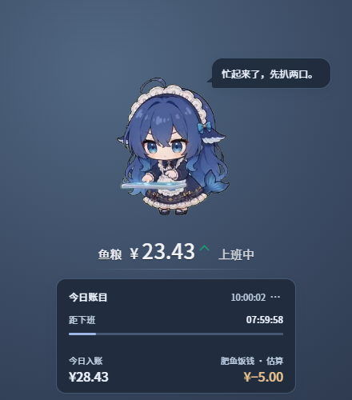
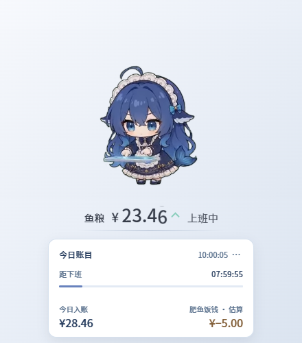
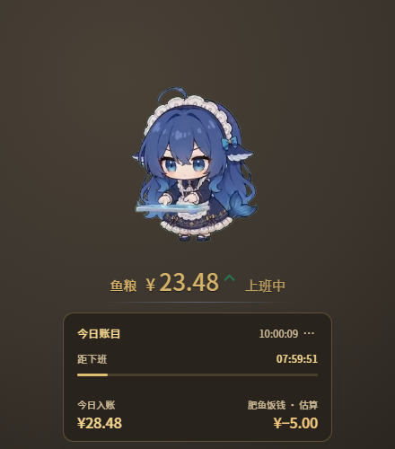
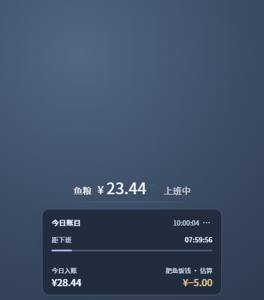
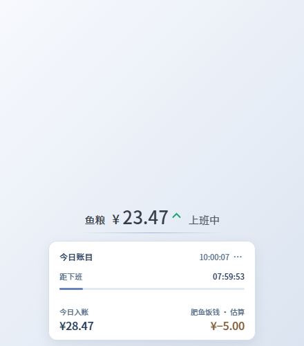
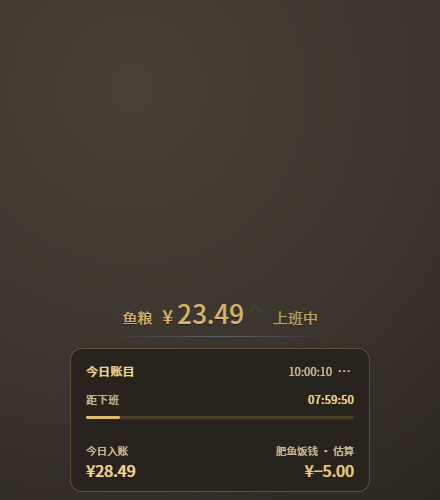

# SalaryMeter · 桌面工资挂件

打工养肥鱼。一个浮在桌面上的工资小挂件：鲸鱼娘在旁边吃饭，脚下一条透明的鱼粮，显示今天挣了多少、离下班还有多久、AI 又吃了多少钱。


点鱼粮金额或状态文字（如「上班中」）展开今日账目，再点一次收起：


> 上面的截图来自本地 Electron 渲染检查：读数是测试用合成数据，窗口后面的大块桌面色是模拟背景，不是挂件新增的底板。本地候选已构建并运行，尚未发布；最终观感待用户验收。

## 三档外观

三种主题共用同一套信息层级，只换颜色：

| 深色 | 浅白 | 暗金 |
| --- | --- | --- |
| 深蓝灰账目 · 雾蓝字 | 柔白账目 · 墨蓝字 | 暖黑账目 · 浅金字 |
|  |  |  |

隐藏人物后仍然是一条完整的工资挂件，鱼粮条和展开账目都保留；因为窗口不缩，鱼粮的屏幕位置不会因开关人物而跳：

| 深色 · 隐藏人物 | 浅白 · 隐藏人物 | 暗金 · 隐藏人物 |
| --- | --- | --- |
|  |  |  |

## 功能

- **今日打工入账**：按月薪、每月工作日、上下班时间、午休时长，按秒累加。
- **下班倒计时**：上班中 / 午休中 / 已收工 / 休息日都会跟着变；休息日和已收工会自动省掉倒计时和进度条。
- **偷吃（模型饭钱）**：按 token 用量折算，DeepSeek 工作日 9–12、14–18 走高价款，其余时段五折，其他厂商平价。
- **三档外观**：深色 / 浅白 / 暗金，切换立即生效，并自动保存。
- **鱼粮数字**：恢复美化前的字号与配色，整数和小数同字号（随位数在 16–26px 间调整），汉字 15px；保留逐位滚动。涨钱闪绿、扣钱变红并显示方向箭头；负数和「有遗漏」的 `≤ / ≥` 都不会被裁掉。
- **展开账目**：300 × 144 的卡片，上方是「今日账目 / 时间」和下班倒计时、进度条，下方两列是今日入账和肥鱼饭钱；饭钱一直标着估算口径。
- **人物动画开关**：关掉后不再加载人物视频、释放视频解码器，只留鱼粮和账目；不会清空余额，也不会触发无人物彩蛋。人物大小会保留，重开即恢复。
- **设置自动保存**：月薪、工作日、上下班时间、午休、休息制度、主题、大小和人物开关改完即保存，不需要再点「保存参数」。关闭人物时只停用「大小」和「恢复默认」，其他参数照常可改。
- **右键设置**：右键人物、鱼粮金额或状态文字、展开的账目卡，都直接打开设置；隐藏人物也能用。鱼粮栏不再弹出金额解释的悬停文字，左键仍用于收起/展开。
- **自检**：设置里能看到今日已算 / 未算多少笔、合计多少、价格表来源，还有一个「重算今天的账」按钮。
- **桌面浮层**：可以拖动鱼粮条或账目标题栏移动位置，位置会记住；托盘菜单可切换外观、始终置顶、鼠标穿透和退出。空白区域交给窗口穿透机制放行，不挡下面的程序。


设置窗口通常为 466 × 660；屏幕工作区较小时缩短窗口，并允许内部滚动，底部内容仍可到达。

## 自己编译

需要 Node 18+、Rust 稳定版、WebView2（Win10/11 自带）。

```powershell
npm install
npm run tauri:build
```

构建前先退出正在运行的挂件，否则 EXE 会被占用。

产物：

- `src-tauri\target\release\salary-widget.exe`
- `src-tauri\target\release\bundle\nsis\SalaryMeter_0.2.4_x64-setup.exe`

当前本地候选版本是 **desktop 0.2.4**。2026-11-10 的界面改动已构建，EXE 和 Setup 已复制至 `E:\SalaryMeter\`，并恢复日常挂件运行。尚未发布，也未代表用户验收通过。

目录说明：

- `renderer/` —— 挂件页（`index.html`、`widget.js`）和设置页（`settings.html`）
- `renderer/assets/` —— 三主题样式、字体和人物资源；当前运行截图放在 `docs/`
- `renderer/assets/webm/`、`renderer/pet-scenes.mjs` —— 十二段人物动画和场景映射，是插件版同名文件的拷贝；改的时候两边一起改
- `checks/` —— Electron / 浏览器回归检查，包括三主题十二种状态、命中区域、金额滚动和设置页
- `src-tauri/src/ledger.rs` —— 扫会话日志、算钱
- `src-tauri/src/lib.rs` —— 窗口、托盘、命令

## 数据是怎么来的

挂件自己不调用模型，它读的是 [DS Bot](https://github.com/Fei2411/DeepSeek-Bot)（DeepSeek Harness 桌面端）留在磁盘上的会话日志：

```
%USERPROFILE%\.ds-bot\sessions\<分组>\session-*\session.v4.jsonl.zstd
```

日志是多个 zstd 帧首尾相接的 JSONL，程序按帧流式解压，挑出今天的 `usage` 事件，按当时生效的模型单价折算。只读当天写过的会话文件，DS Bot 关着也能算。

价格表内置 36 个常见模型（DeepSeek / GLM / Step / Kimi / Qwen / MiniMax / OpenAI / Claude / Gemini / Grok），美元价按 7.15 折算人民币。节假日调整、搜索抓取、辅助调用没有计入。

挂件的配置、当天费用统计和位置保存在 `%APPDATA%\com.local.salarymeter\`。DSH 窗口里那条 248×88 的小工资条由插件版提供，和这个桌面窗口分开，本轮没有改。

## 这一轮核对到哪里

- 已在 Electron 渲染器里跑过三主题 × 人物显示/隐藏 × 收起/展开共 12 种状态，检查鱼粮位置、账目卡 300 × 144、内容不溢出、两列同一行、隐藏人物后视频 `src` 释放。
- 已检查大金额与负数相互切换、未知费用的 `≤ / ≥`、扣钱红字和向下箭头、命中区数据，以及设置页三主题和关闭人物后的禁用范围。
- 完整 `ui-polish.cjs` 已通过：12 种挂件状态、三主题设置、焦点环、人物开关与大小保存、500 高窗口内部滚动、错误提示不遮挡金额。隐藏测试窗口需开启浏览器焦点模拟，不能把测试窗口未激活误判成产品无焦点样式。
- 拖动、命中区、逐位滚动、扣钱冻结、紧凑账目、滑块鼠标操作、主题保存与字体检查通过；Rust 11 条单测通过。
- **原生验证另记**：快速点击穿透、展开时贴屏幕底部、非 100% DPI、多显示器不能由 Electron 测试代替。最终验收由用户确认。
- Windows 原生已实测设置入口、三主题、滑块鼠标拖动 100%→150%、人物开关只禁用大小/恢复默认、重新开启保留150%、配置落盘、关闭设置及账目收起/展开；日常配置仍为暗金/隐藏人物/收起账目。靠屏幕底边的专项操作、多显示器及极快点击穿透尚未覆盖。

## 授权

桌面余额栏使用随应用打包的 Noto Sans CJK SC Regular / Medium 开源字体**子集**（SIL OFL 1.1，只保留界面实际用到的 797 个码点，两个 woff2 共 508,964 字节；原字体 32.9MB 不再打进产物）。原字体放在 `fonts-src/`，改了界面文案用 `tools/subset-fonts.py` 重新裁剪。来源与许可见 [字体说明](renderer/assets/fonts/README.md) 和 [OFL](renderer/assets/fonts/OFL.txt)；发布源码与安装包时保留这些文件，字体许可独立于项目 MIT 许可。子集之外的字符会回退到系统字体，不会出现方块。

代码沿用同作者 [dsh-salary-meter](https://github.com/Jiang-Xiaoxing/dsh-salary-meter) 插件的 MIT 授权。

**十二段人物动画**：其中十段（大口吃零食、忙起来、偷吃被抓住、午休涮火锅、趴着睡、收工蹦、晨间刷牙、悠闲哼歌、开黑打游戏、待机发呆）取自 [PC2005-cloud/dsh-pet](https://github.com/PC2005-cloud/dsh-pet) 的 `assets/webm`，那是 MIT 授权的开源桌面宠物（许可证全文见仓库根目录的 [`LICENSE-dsh-pet`](../LICENSE-dsh-pet)）。`加班熬夜` 和彩蛋用的 `伸手抓抓抓` 是按 dsh-pet 公开的抠图流程自己做的（AI 生成绿幕 → 站位归一化 → 转透明 VP9），不是原作者提供的动画，随本项目 MIT 授权。改动画时两边的 `renderer/assets/webm` 要一起改。

旧版图集人物的立绘是社区「大肥鱼」鲸鱼娘形象的自制素材，参考了 [dsh-pet](https://github.com/PC2005-cloud/dsh-pet) 的二创形象。桌面版已经不用这套图集了：视频读不出来时人物先隐藏，每 60 秒自动重试一次视频；图集现在只留在插件版（DSH 窗口里）使用。动画与形象的著作权归各自作者，二次使用请署名。
