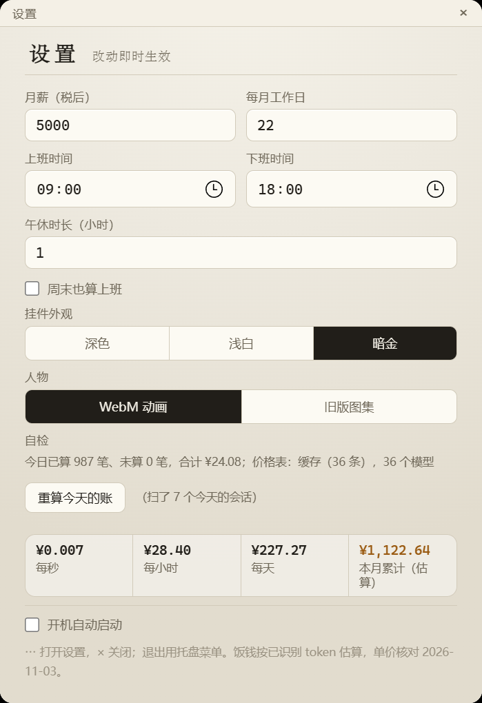

# SalaryMeter · 桌面工资挂件

打工养肥鱼。一个浮在桌面上的小胶囊：今天挣了多少、离下班还有多久、AI 又吃了多少钱。


展开之后会有鲸鱼娘在吃饭，下面是今日入账和饭钱：


## 功能

- **今日打工入账**：按月薪、每月工作日、上下班时间、午休时长，按秒累加。
- **下班倒计时**：上班中 / 午休中 / 已收工 / 休息日都会跟着变。
- **偷吃（模型饭钱）**：按 token 用量折算，DeepSeek 工作日 9–12、14–18 走高价款，其余时段五折，其他厂商平价。
- **三档外观**：深色 / 浅白 / 暗金，点一下立即生效。
- **九段人物动画**：上班吃东西、忙起来、午休涮火锅、下班庆祝、早上刷牙、休息哼歌、加班熬夜、被抓住偷吃，按状态自动切换；视频读不出来时退回旧版图集。
- **自检**：设置里能看到今日已算 / 未算多少笔、合计多少、价格表来源，还有一个「重算今天的账」按钮。
- **桌面浮层**：可以拖到桌面任意位置，能置顶、能鼠标穿透，带托盘图标和开机自启。



## 下载

到 [Releases](../../releases) 下载：

- `SalaryMeter-Setup.exe` —— 安装版（开机自启等交给安装器注册）
- `SalaryMeter.exe` —— 免安装，直接双击就能跑

只支持 Windows x64（Tauri + WebView2）。

## 用法

- 拖动胶囊任意空白处可以移动，位置会记住。
- 点「展开 ⌃」露出人物，点人物会被抓个正着。
- 点右上角 `⋯` 打开设置：月薪、工作日、上下班时间、午休、外观、人物、自检。
- 托盘图标右键：外观循环切换、始终置顶、鼠标穿透、开机自启、退出。

## 数据是怎么来的

挂件自己不调用模型，它读的是 [DS Bot](https://github.com/Fei2411/DeepSeek-Bot)（DeepSeek Harness 桌面端）留在磁盘上的会话日志：

```
%USERPROFILE%\.ds-bot\sessions\<分组>\session-*\session.v4.jsonl.zstd
```

日志是多个 zstd 帧首尾相接的 JSONL，程序按帧流式解压，挑出今天的 `usage` 事件，按当时生效的模型单价折算。只读当天写过的会话文件，DS Bot 关着也能算。

价格表内置 36 个常见模型（DeepSeek / GLM / Step / Kimi / Qwen / MiniMax / OpenAI / Claude / Gemini / Grok），美元价按 7.15 折算人民币。节假日调整、搜索抓取、辅助调用没有计入。

## 自己编译

需要 Node 18+、Rust 稳定版、WebView2（Win10/11 自带）。

```powershell
npm install
npm run tauri:build
```

产物：`src-tauri\target\release\salary-widget.exe` 和 `src-tauri\target\release\bundle\nsis\SalaryMeter_0.2.0_x64-setup.exe`。

目录说明：

- `renderer/` —— 界面（胶囊页 `index.html` + `widget.js`，设置页 `settings.html`）
- `renderer/assets/webm/` 和 `renderer/pet-scenes.mjs` —— 九段人物动画和场景映射，是插件版同名文件的拷贝；改的时候两边一起改
- `src-tauri/src/ledger.rs` —— 扫会话日志、算钱
- `src-tauri/src/lib.rs` —— 窗口、托盘、命令
- `assets/`、`main.js`、`preload.js`、`网页版-salary-meter.html` —— 早期的 Electron 版本，留作参考

## 授权

代码沿用同作者 [dsh-salary-meter](https://github.com/Jiang-Xiaoxing/dsh-salary-meter) 插件的 MIT 授权。

**九段人物动画来自 [PC2005-cloud/dsh-pet](https://github.com/PC2005-cloud/dsh-pet)（MIT）**，许可证全文见仓库根目录的 [`LICENSE-dsh-pet`](../LICENSE-dsh-pet)。其中八段取自该仓库的 `assets/webm`；`加班熬夜` 是按 dsh-pet 的抠图流程另外生成的，不是原作者提供的动画。

旧版图集人物（设置里可切回）的立绘是社区「大肥鱼」鲸鱼娘形象的自制素材，参考了 [dsh-pet](https://github.com/PC2005-cloud/dsh-pet) 的二创形象。动画与形象的著作权归各自作者，二次使用请署名。
